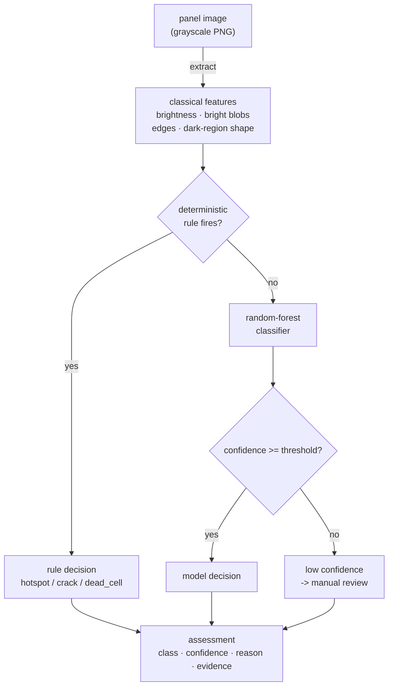

# SolarVision

Offline, deterministic defect detection for solar-panel imagery. SolarVision
reduces a grayscale panel image to a vector of **classical** computer-vision
features, decides the unambiguous cases with a transparent **rule layer**, and
sends the rest to a small classifier — then reports *why* it decided what it did.
There is no pretrained model, no dataset download and no network access; the whole
pipeline is reproducible bit-for-bit from a seed.

[](.github/workflows/ci.yml)
[](pyproject.toml)
[](LICENSE)

---

## Why it matters

It is easy to build a solar-panel "defect detector" that reports 99% accuracy and
is quietly worthless: render some synthetic images, split them at random, and the
model simply re-reads defect configurations it already memorised. SolarVision
refuses that shortcut. It detects three defect types against healthy panels —

- **hotspot** — a localised bright blob (a shaded or shunted cell running hot),
- **crack** — a thin, dark, randomly oriented streak (a wafer micro-crack), and
- **dead_cell** — a compact solid dark block (an inactive cell) —

— and it is **evaluated on held-out defect configurations** (contrasts and sizes
never seen in training), so the headline accuracy is the honest generalisation
number, not a memorised ~1.0. Where the model is unsure, it says so and routes the
image to manual review.

## How it works



1. **Generator (`generate.py`).** Renders grayscale panels from scratch with NumPy:
   a regular cell grid, an illumination gradient, per-cell jitter and sensor noise,
   with an optional defect stamped on top. Each defect has a scalar **severity** and
   **size**, so instances range from barely-above-noise to obvious.
2. **Features (`features.py`).** Hand-defined, nameable statistics computed with
   `scipy.ndimage`: global brightness stats; a bright-blob detector (robust
   threshold + connected components) for hot spots; Sobel edge density with a
   diagonal share for cracks; and dark-region shape (area, elongation, box-fill)
   to tell a thin crack from a blocky dead cell. Thresholds are **robust** (median
   + MAD) so the anomaly cannot inflate its own threshold and hide.
3. **Detector (`detector.py`).** A deterministic rule layer handles the clear cases
   (a very bright blob is a hot spot; a long thin dark streak is a crack; a large
   solid dark block is a dead cell). Everything ambiguous falls through to a seeded
   `RandomForestClassifier`. The result names the rule that fired or the features
   that weighed most, plus a confidence and the full class probabilities.

## Quick start

```bash
python -m venv .venv && source .venv/bin/activate
pip install -e ".[dev]"

python -m solarvision.cli demo          # render one panel of each type and detect
python -m solarvision.evaluation        # honest held-out accuracy over several seeds
uvicorn solarvision.main:app --reload   # HTTP API
```

Example API calls:

```bash
# Assess a generated sample by id (defect type + seed); returns ground truth too
curl -s -X POST localhost:8000/assess -H 'content-type: application/json' \
  -d '{"sample": {"defect": "hotspot", "seed": 2}}'

# Assess an arbitrary grayscale PNG supplied as base64
curl -s -X POST localhost:8000/assess -H 'content-type: application/json' \
  -d "{\"image_base64\": \"$(base64 -w0 panel.png)\"}"

# The class vocabulary
curl -s localhost:8000/classes
```

## Configuration

Settings load from environment variables with the `SV_` prefix (see
`.env.example`):

| Variable                  | Default | Meaning                                                        |
| ------------------------- | ------- | -------------------------------------------------------------- |
| `SV_MIN_CONFIDENCE`       | `0.55`  | Below this model confidence, an assessment is sent to review   |
| `SV_HOTSPOT_CONTRAST_Z`   | `6.0`   | Robust-z blob contrast above which the hot-spot rule fires     |
| `SV_DEAD_CELL_DARK_FRAC`  | `0.020` | Dark-area fraction above which the dead-cell rule fires        |
| `SV_CRACK_MIN_ELONGATION` | `4.0`   | Dark-region elongation above which the crack rule fires        |

## Evaluation: an honest held-out number, not a memorised 1.0

The panels are synthetic, so a random train/test split would report a meaningless
~1.0: the test set would reuse the exact defect configurations seen in training.
`solarvision.evaluation` instead runs a **bin-disjoint split** — whole severity and
size bins are held out of training, so every test defect is a contrast/size
configuration the model never saw. The held-out bins are interleaved across the
full range, so train and test face the same spread of difficulty:

```
$ python -m solarvision.evaluation
  accuracy (mean+/-std over 5 seeds): 0.88 +/- 0.03   # four classes; chance ~0.25; defect configs unseen in training
  macro-F1 (mean over 5 seeds)      : 0.89
  train accuracy                      : 0.98
  train-test gap                      : 0.10   # bounded -> real signal, not configs
```

The command averages over several seeds on purpose: a single split can land on a
lucky 0.91 (or an unlucky 0.83), and reporting either alone would be the same
self-deception as the random split. What this number does and does not claim,
stated plainly:

- It **does** claim the detector generalises to *unseen* defect contrasts and
  sizes: it interpolates across the held-out bins because the features vary
  smoothly with severity, and the train/test gap stays small (~0.10), which is the
  signature of learning the signal rather than memorising configurations.
- It does **not** claim perfection. The faint end of the severity range genuinely
  overlaps the healthy class under sensor noise, and that is where the ~12% of
  errors land (mostly faint defect vs healthy, and faint crack vs dead cell).
  Closing that gap is not a matter of more synthetic data.

Because the model can be wrong, it never asserts a weak call: a low-confidence
classification is flagged for manual review, and the clear cases are decided by
the transparent rule layer instead.

## Testing

```bash
ruff check solarvision tests
pytest --cov=solarvision --cov-report=term-missing --cov-fail-under=80
```

The suite covers feature extraction (each defect's signature and the healthy
baseline), the detector on every defect type, the rule layer and the
low-confidence review path, the honest held-out evaluation (accuracy above a floor
*and* a bounded train/test gap), the HTTP API (base64 image and generated sample,
plus the error paths), and the CLI demo.

## Documentation

- `docs/architecture.md` — components, data flow, and the design rationale.
- `docs/adr/` — the main design decisions and their trade-offs.
- `docs/estudio/` — a study guide in Spanish, for learning the project in depth.

## A note on scope

SolarVision is a reference implementation on a **synthetic** benchmark, not
certified inspection software. It demonstrates a clean, explainable classical-CV
pipeline with an honest evaluation. A production system would be trained and
validated on real labelled **electroluminescence or thermal** imagery and would
almost certainly use a convolutional network; the honest baseline to beat there is
this held-out score, not the within-distribution ~1.0. The synthetic renderer is a
controlled stand-in for that imagery, not a claim about real-world accuracy.

## License

MIT. See [LICENSE](LICENSE).
