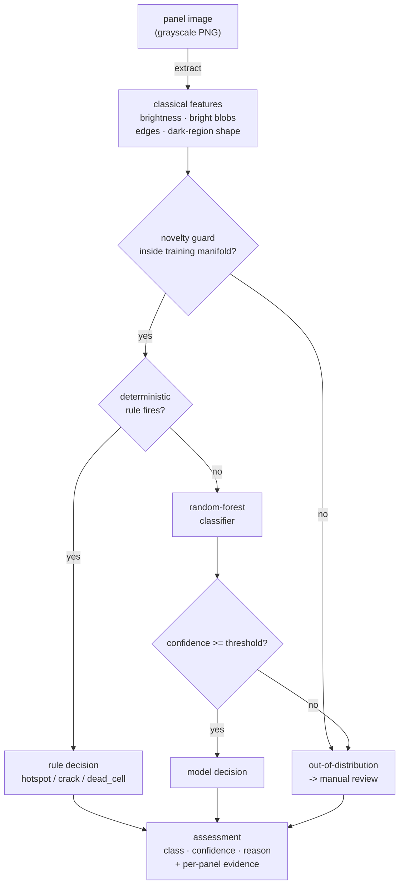

# Architecture

SolarVision has a deterministic, classical computer-vision core. There is no
neural network, no pretrained weights and no network access: a panel image is
reduced to a small vector of hand-defined features, a transparent rule layer
decides the unambiguous cases, and a small classifier handles the rest. Every
decision carries the reason that produced it.

## Components

| Component    | File                       | Responsibility                                            |
| ------------ | -------------------------- | --------------------------------------------------------- |
| Labels       | `solarvision/labels.py`    | The four-class defect taxonomy and its descriptions       |
| Generator    | `solarvision/generate.py`  | Synthetic labelled panels + the bin-disjoint split + I/O  |
| Features     | `solarvision/features.py`  | Classical CV features (brightness, blobs, edges, shape)   |
| Detector     | `solarvision/detector.py`  | Rule layer + random-forest classifier, explainable report |
| Evaluation   | `solarvision/evaluation.py`| Honest held-out generalisation measurement                |
| Service      | `solarvision/service.py`   | Orchestration: render/decode → features → assess          |
| HTTP API     | `solarvision/main.py`      | REST surface over the service                             |
| CLI          | `solarvision/cli.py`       | End-to-end demo with an ASCII preview                     |

## Data flow

## Why classical computer vision

The brief is explicitly offline and deterministic: no model or dataset downloads,
no network. That rules out a pretrained CNN, and training a CNN from scratch on
synthetic data would only teach it the quirks of the renderer. Classical features
are the honest fit: each one is a statistic a technician can name — "how bright is
the brightest blob", "how elongated is the darkest region" — so the whole system
is inspectable and reproducible bit-for-bit from a seed.

## Why a rule layer in front of the model

Some defects are visually unambiguous: a blob six robust standard deviations above
its surroundings *is* a hot spot, and no statistical model should be allowed to
second-guess that with lower confidence. The rule layer encodes exactly those
clear cases as thresholds on the features, so the decision is self-explaining. The
rules fire only on strong evidence; everything in the ambiguous middle falls
through to the classifier.

## Why the classifier never hides behind a perfect score

The features are continuous functions of the defect's severity and size, so a
faint defect produces a weak signal that genuinely overlaps the healthy class
under sensor noise. The evaluation holds out whole severity/size bins, so the test
defects are configurations never seen in training; the reported accuracy is the
honest generalisation number (~0.88 averaged over seeds, see `evaluation.py`), not
a memorised ~1.0. Low-confidence calls are flagged for manual review rather than
asserted.

## Why a novelty guard, and why per-panel evidence

A classifier trained on panels will still return *some* class, confidently, for an
input that is not a panel at all — a blank frame, a photo of something else, an
unseen artefact. To stop that confident-but-meaningless answer, an **isolation
forest** fitted on the training features acts as a novelty guard: a panel whose
features fall outside the training manifold is marked out-of-distribution and sent
to review, regardless of the classifier's confidence. The explanation is also made
**per panel**: rather than the forest's global importances (identical for every
image), the report surfaces the features of *this* panel that deviate most from a
typical one, as signed z-scores — the measurements that actually drove this
decision.

## Scope

SolarVision is a reference implementation on a **synthetic** benchmark, not a
production inspection system. A real deployment needs labelled electroluminescence
or thermal imagery and, almost certainly, a convolutional network; the honest
baseline to beat there is this held-out score, not the within-distribution ~1.0.
